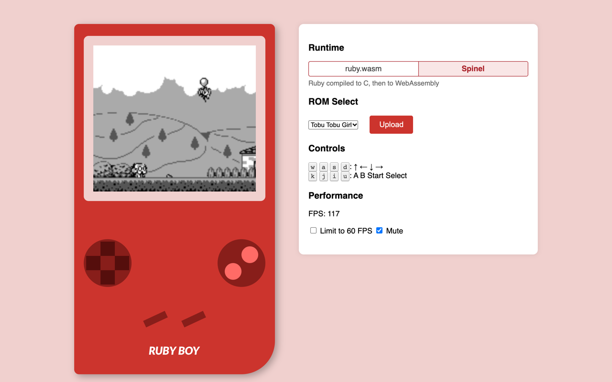
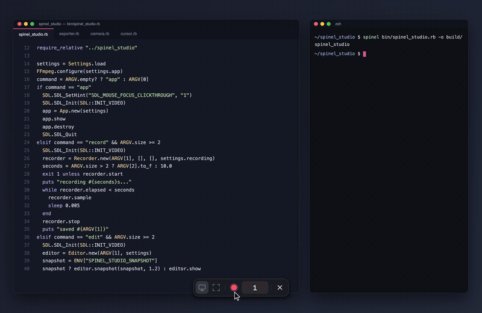
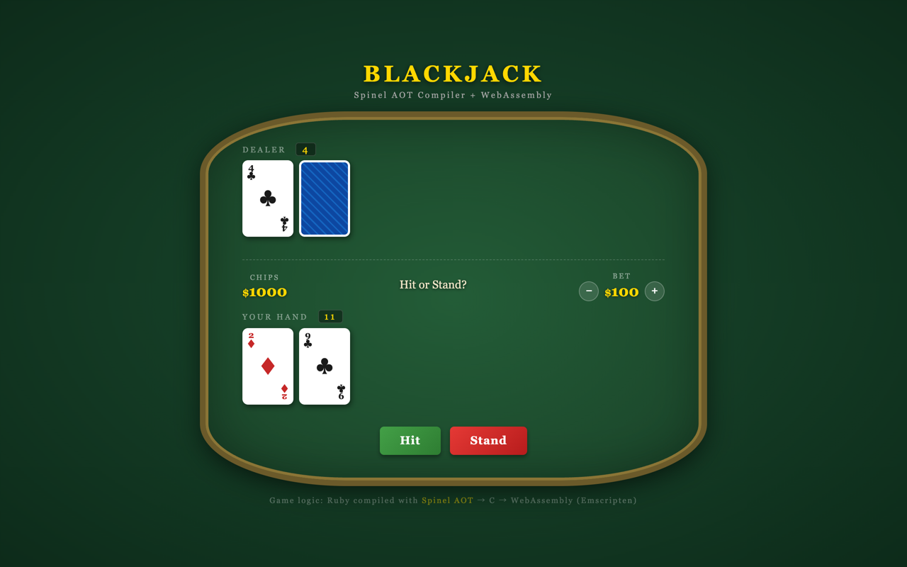

# Awesome Spinel

A curated list of programs, libraries and tools that run on [Spinel](https://github.com/matz/spinel), the ahead-of-time Ruby compiler that turns Ruby source into a single native binary (or WebAssembly).

If you build something with Spinel, [add it](CONTRIBUTING.md).

## Contents

- [Showcase](#showcase)
- [Official](#official)
- [Games and graphics](#games-and-graphics)
- [Audio and hardware](#audio-and-hardware)
- [Web frameworks and servers](#web-frameworks-and-servers)
- [Applications and command-line tools](#applications-and-command-line-tools)
- [Libraries](#libraries)
- [Developer tooling](#developer-tooling)
- [Bridges and experiments](#bridges-and-experiments)
- [Learning](#learning)

## Showcase

<table>
<tr>
<td width="50%" valign="top">

<b><a href="https://github.com/MatheusRich/spinelcraft">Spinelcraft</a></b>: a small Minecraft-like game. All game logic is Ruby compiled by Spinel; SDL3 GPU (Metal on macOS) draws it, through a thin C layer.
</td>
<td width="50%" valign="top">

<b><a href="https://github.com/sacckey/rubyboy">Rubyboy</a></b>: a Game Boy emulator written in Ruby. Compiled by Spinel it runs at about 800 FPS on an Apple M4, against 110 on CRuby and 290 with YJIT. <a href="https://sacckey.github.io/rubyboy/spinel/">Play it in the browser</a>.
</td>
</tr>
<tr>
<td width="50%" valign="top">

<b><a href="https://github.com/aristotelesbr/spinel-studio">Spinel Studio</a></b>: a screen recorder for macOS, written in Ruby and compiled to a native app by Spinel.
</td>
<td width="50%" valign="top">

<b><a href="https://github.com/risgk/midi_synthesizer_spms1">SPMS-1</a></b>: a semi-modular MIDI synthesizer for the Raspberry Pi Pico 2, made with Spinel. It also runs in the browser inside its own editor.
</td>
</tr>
<tr>
<td width="50%" valign="top">

<b><a href="https://github.com/machida/bj">Blackjack</a></b>: the game logic is one Ruby file, compiled by Spinel to C and by Emscripten to WebAssembly. <a href="https://machida.github.io/bj/">Play it</a>.
</td>
<td width="50%" valign="top">

<b><a href="https://github.com/hoshinotsuyoshi/herdr-agent-rate">herdr-agent-rate</a></b>: shows Claude Code and Codex rate limits as bars in Herdr, fed by <code>agent-rate</code>, a small Spinel-compiled helper.
</td>
</tr>
<tr>
<td width="50%" valign="top">

<b><a href="https://github.com/jockofcode/starlane_concordat">Starlane Concordat</a></b>: a BBS-door-style space trading sim, built with SDL on Spinel.
</td>
<td width="50%" valign="top">
<b><a href="https://github.com/OriPekelman/toy">toy</a></b>: a transformer language model framework in Ruby, compiled by Spinel to native code with CUDA and Metal support. It runs real HuggingFace models (SmolLM2, Llama 3, Qwen, Mistral, Gemma 2) with output matched against PyTorch.
  
<b><a href="https://github.com/kazuho/regexpinel">regexpinel</a></b>: a proof-of-concept <code>Regexp</code> engine for CRuby. The VM is written in Ruby and compiled by Spinel into an allocation-free C function, then wrapped as a CRuby extension.
</td>
</tr>
</table>

## Official

- [Spinel](https://github.com/matz/spinel) - The compiler, with `spin`, its package manager, and the in-tree tools (`spinel-doctor`, `spinel-reduce`, `spinel diff`).
- [spin-index](https://github.com/matz/spin-index) - The package index `spin` resolves against.
- [optcarrot](https://github.com/mame/optcarrot) - The NES emulator benchmark. Spinel compiles it as part of its own test gate.

## Games and graphics

- [Spinelcraft](https://github.com/MatheusRich/spinelcraft) - Minecraft-like game: Ruby game logic, SDL3 GPU rendering.
- [Rubyboy](https://github.com/sacckey/rubyboy) - Game Boy emulator; compiles unchanged and runs about 7x faster than CRuby. [Browser demo](https://sacckey.github.io/rubyboy/spinel/).
- [Blackjack](https://github.com/machida/bj) - Blackjack in the browser through Spinel and Emscripten. [Play](https://machida.github.io/bj/).
- [raylib-spinel](https://github.com/rebuilt/raylib-spinel) - raylib bindings as a spin package; projects written for the `raylib-bindings` gem need no source changes.
- [sdl](https://github.com/jockofcode/sdl) - SDL library for Spinel.
- [sdl_ui](https://github.com/jockofcode/sdl_ui) - Immediate-mode UI library on top of SDL, inspired by Dear ImGui.
- [Vector Blaster 2000](https://github.com/jockofcode/vector_blaster_2000) - Asteroids-style vector shooter.
- [Invaders](https://github.com/jockofcode/invaders) - Space Invaders-style shooter.
- [Bullet Hell Shrine](https://github.com/jockofcode/bullet_hell_shrine) - Danmaku dodge shooter.
- [Stackdown](https://github.com/jockofcode/stackdown) - Falling-block puzzle game.
- [Falling Sand](https://github.com/jockofcode/falling_sand) - Cellular-automaton sandbox.
- [Net Pong](https://github.com/jockofcode/net_pong) - Two-player Pong over UDP.
- [Starlane Concordat](https://github.com/jockofcode/starlane_concordat) - BBS-door-style space trading sim.
- [Scroll Merchant](https://github.com/jockofcode/scroll_merchant) - Mouse-wheel shop management game.
- [Word Storm](https://github.com/jockofcode/word_storm) - Typing game with a bundled font.
- [Feed the Fish](https://github.com/jockofcode/feed_the_fish) - Small SDL example game.

## Audio and hardware

- [SPMS-1](https://github.com/risgk/midi_synthesizer_spms1) - MIDI synthesizer for the Raspberry Pi Pico 2 (and in the browser).
- [spinel-sonic-lab](https://github.com/tackaaaada/spinel-sonic-lab) - Compose in Spinel-compiled Ruby, schedule in Rust, play live through SuperCollider.

## Web frameworks and servers

- [tep](https://github.com/OriPekelman/tep) - Sinatra-flavoured web framework that compiles to a native binary.
- [Snails](https://github.com/snails-rb/snails) - Rails-like framework for API-only apps, compiled into one binary.
- [CyberTrain](https://github.com/saeki-mototsune/CyberTrain) - Rails-shaped web framework written natively for Spinel, with a [guide and playground](https://saeki-mototsune.github.io/CyberTrain/).
- [Kilau](https://github.com/yosefbennywidyo/kilau) - Loco-style web framework; the same suite runs on CRuby and Spinel.
- [spinrail](https://github.com/ceritium/spinrail) - Rails-inspired web framework.
- [spin](https://github.com/ahoward/spin) - Minimalist framework with flat Sinatra-style handlers, compiled to native or wasm and runnable behind any transport.
- [dormouse](https://github.com/spinelex/dormouse) - Rack 3 server in plain Ruby.
- [kiln](https://github.com/roman-haidarov/kiln) - HTTP/1.1 server and router built on libuv and picohttpparser.
- [spinel-http](https://github.com/aristotelesbr/spinel-http) - HTTP/1.1 server in plain Ruby that also runs unchanged on CRuby.
- [Roundhouse](https://github.com/rubys/roundhouse) - Transpiles Rails applications to plain Ruby that Spinel compiles; Campfire passes its own test suite under Spinel.
- [spinel-mastodon-streaming](https://github.com/rubys/spinel-mastodon-streaming) - Mastodon's streaming server as one static binary, replacing the Node process.
- [discourse-spinel](https://github.com/sam-saffron-jarvis/discourse-spinel) - Work-in-progress, read-only Discourse extraction compiled with Spinel.

## Applications and command-line tools

- [Spinel Studio](https://github.com/aristotelesbr/spinel-studio) - A screen recorder for macOS, written in Ruby and compiled to a native app by Spinel.
- [pinky](https://github.com/ideasasylum/pinky) - Local knowledge base for coding agents: SQLite, FTS5, sqlite-vec and static embeddings in one binary.
- [herdr-agent-rate](https://github.com/hoshinotsuyoshi/herdr-agent-rate) - Claude Code and Codex rate-limit bars for Herdr.
- [spinel-bundler-audit](https://github.com/aristotelesbr/spinel-bundler-audit) - Standalone alternative to bundler-audit.
- [laburos](https://github.com/gramos/laburos) - Job finder that runs on a Raspberry Pi and sends e-mail reports.
- [nix_utils](https://github.com/jockofcode/nix_utils) - Unix utilities rewritten in Ruby for Spinel.

## Libraries

Gems ported to Spinel and native packages for `spin`.

- **Data stores**
  - [spinel-pg](https://github.com/roundhouse-rb/spinel-pg) - PostgreSQL client (v3 wire protocol, SCRAM-SHA-256).
  - [spinel-redis](https://github.com/roundhouse-rb/spinel-redis) - Redis client, require-compatible with redis-rb.
  - [spinel-sqlite](https://github.com/yosefbennywidyo/spinel-sqlite) - SQLite, with a CRuby backend for parity.
- **HTML, Markdown and images**
  - [spinel-nokogiri](https://github.com/roundhouse-rb/spinel-nokogiri) - Nokogiri: HTML parsing, CSS/XPath and serialization over libxml2.
  - [spinel-loofah](https://github.com/roundhouse-rb/spinel-loofah) - Loofah, the HTML sanitizer.
  - [spinel-crass](https://github.com/roundhouse-rb/spinel-crass) - Crass, the CSS parser.
  - [spinel-commonmarker](https://github.com/roundhouse-rb/spinel-commonmarker) - commonmarker over cmark-gfm.
  - [spinel-rqrcode](https://github.com/roundhouse-rb/spinel-rqrcode) - rqrcode, byte-identical QR output.
  - [spinel-ruby-vips](https://github.com/roundhouse-rb/spinel-ruby-vips) - ruby-vips: header reads, thumbnails and encoding over libvips.
- **CLI and terminal**
  - [spinel-thor](https://github.com/Sology/spinel-thor) - Thor.
  - [spinel-bubbletea](https://github.com/Sology/spinel-bubbletea) - bubbletea.
  - [ncurses](https://github.com/jockofcode/ncurses) - ncurses bindings.
- **Security and cloud**
  - [spinel-webauthn](https://github.com/Sology/spinel-webauthn) - webauthn.
  - [bcrypt-spinel](https://github.com/snails-rb/bcrypt-spinel) - OpenBSD bcrypt().
  - [spinel-aws-sdk-core](https://github.com/aristotelesbr/spinel-aws-sdk-core) - aws-sdk-core, with sigv4, eventstream and SSM siblings.
- **Standard library surface**
  - [spinelkit](https://github.com/OriPekelman/spinelkit) - JSON, Git and Log shims for AOT-compiled apps.

## Developer tooling

- [spinelgems](https://github.com/OriPekelman/spinelgems) - Which RubyGems compile under Spinel; browse it at [spinelgems.org](https://spinelgems.org).
- [spinel-dev](https://github.com/OriPekelman/spinel-dev) - Value bisector for silent miscompiles, a ruby-lsp type addon, and flamegraph analysis.
- [rubocop_spinel](https://github.com/gurgeous/rubocop_spinel) - RuboCop cop that flags Ruby Spinel does not support yet.
- [spinel-differential-fuzzer](https://github.com/fc-anjos/spinel-differential-fuzzer) - Differential fuzzer against CRuby that surfaces silent miscompiles.
- [asdf-spinel](https://github.com/jockofcode/asdf-spinel) - asdf plugin to install Spinel.
- [app_bundler](https://github.com/jockofcode/app_bundler) - Packages a compiled binary into a macOS `.app` bundle.

## Bridges and experiments

- [regexpinel](https://github.com/kazuho/regexpinel) - Regexp engine for CRuby, written in Ruby and compiled by Spinel.
- [toy](https://github.com/OriPekelman/toy) - Transformer LM framework with CUDA and Metal support.
- [spinel-ebpf](https://github.com/yuskesh/spinel-ebpf) - Write eBPF programs in Ruby; eligible methods compile to `.bpf.c`, the rest stays native.
- [spinel_native](https://github.com/khasinski/spinel_native) - Compile individual Ruby methods to native code from inside CRuby.
- [s245](https://github.com/luccafort/s245) - Port Ruby methods to Go by chaining Spinel (Ruby to C) and ccgo (C to Go).

## Learning

- [spinel_examples](https://github.com/jockofcode/spinel_examples) - Five commented example apps, with a build script and meetup slides.
- [Spinel documentation](https://github.com/matz/spinel/tree/master/docs) - Limitations, FFI, `spin`, WebAssembly and more.

## License

[CC0 1.0](LICENSE). To the extent possible under law, the contributors have waived all copyright to this list.
